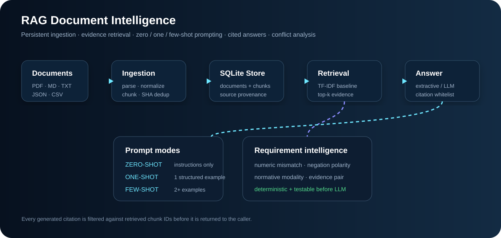

# RAG Document Intelligence

[](https://github.com/cagataykavas/rag-document-intelligence/actions/workflows/ci.yml)

A persistent, evidence-grounded document intelligence service with **multi-format ingestion, hybrid sparse retrieval, zero/one/few-shot prompting, fail-closed generation admission, citation integrity checks, claim-to-evidence tracing, untrusted-document quarantine, quantitative evaluation, REST API and Docker deployment**.



The repository intentionally remains runnable without a paid model API. The default answer path is deterministic/extractive and fully testable. An OpenAI-compatible adapter can be enabled for local or hosted generation when desired.

> Public portfolio implementation only. No employer documents, proprietary requirements, confidential prompts, or private datasets are included.

## Architecture

```mermaid
flowchart LR
    D[PDF / MD / TXT / JSON / CSV] --> P[Parser + normalization]
    P --> H[SHA-256 deduplication]
    H --> C[Metadata-aware chunks]
    C --> S[(SQLite document store)]

    S --> W[Word TF-IDF]
    S --> CH[Character n-gram TF-IDF]
    W --> F[Weighted score fusion]
    CH --> F
    F --> DR[Diversity-aware reranking]
    DR --> E[Retrieved evidence]

    E --> SEC[Untrusted-evidence policy]
    SEC -->|safe| Z[Zero / one / few-shot prompt]
    SEC -->|high risk| Q[Quarantine trace]
    SEC --> ES[Content-bound evidence snapshot]
    Z --> G[Extractive or OpenAI-compatible generator]
    G --> AD[Generation-response admission]
    ES --> AD
    AD --> AU[HMAC-authenticated audit evidence]
    AU --> CV[Citation whitelist + rejected IDs]
    CV --> GA[Grounding audit]
    GA --> CL[Claim-to-evidence trace]

    DR --> RE[Hit / Recall / Precision / MRR / nDCG]
    Z --> PE[Prompt-mode benchmark]
    E --> X[Requirement conflict detector]
```



## Why this is more than a chat wrapper

The engineering work is split into boundaries that can be tested independently:

- **parsing:** PDF, Markdown, text, JSON, and CSV normalization, with page-native PDF boundaries;
- **persistence:** documents and chunks survive process restarts;
- **idempotent ingestion:** SHA-256 prevents silent duplicate indexing;
- **retrieval:** transparent word + character sparse fusion with diversity reranking;
- **prompting:** zero-shot, one-shot, and few-shot are explicit code paths;
- **generation:** optional OpenAI-compatible adapter rather than provider lock-in;
- **generation admission:** exact response schema, resource limits, type checks, citation allowlisting, content-bound evidence snapshots, per-claim citation completeness, and abstention consistency;
- **admission authentication:** optional HMAC-SHA256 evidence with key IDs, rotation support, freshness checks, and constant-time verification;
- **citation integrity:** generated citation IDs are checked against retrieved evidence;
- **claim support:** answer sentences are mapped back to their strongest cited chunk;
- **untrusted evidence:** instruction-like document content is scanned and high-risk chunks are quarantined from generation;
- **conflict analysis:** deterministic numeric, negation, and modality contradiction checks;
- **evaluation:** retrieval, grounding, prompt behavior, calibrated claim entailment, and latency are measured separately.

## Quick start

```bash
python -m venv .venv
source .venv/bin/activate          # Windows: .venv\Scripts\activate
pip install -r requirements.txt

python -m src.cli ingest ./documents
python -m src.cli query "What authentication rule applies to administrators?"
```

Run the service:

```bash
uvicorn app.api:app --reload
# or
docker compose up --build
```

OpenAPI is available at `/docs`.

## Hybrid sparse retrieval

The default retriever deliberately does **not** pretend to be a dense embedding system. It fuses two inspectable sparse signals:

```text
word TF-IDF:       unigrams + bigrams
character TF-IDF:  3–5 character n-grams

fused_score = 0.65 * word_score + 0.35 * character_score
```

Word features favor lexical and phrase matches. Character features improve robustness for requirement IDs, product codes, spelling variation, compound terms, and near-matches. A document-diversity penalty reduces the chance that one long source occupies every top-K slot.

Each retrieval row exposes rank, fused score, component scores, chunk/document IDs, source, and text. Retrieval behavior is therefore inspectable rather than hidden behind an opaque similarity API.

## Query with an evidence trace

```bash
curl -X POST http://localhost:8000/query \
  -H 'content-type: application/json' \
  -d '{
    "question":"How long must audit evidence be retained?",
    "k":5,
    "prompt_mode":"few_shot",
    "use_llm":false
  }'
```

The response contains:

- answer text;
- accepted citation chunk IDs;
- generated-but-rejected citation IDs;
- confidence and insufficient-evidence flag;
- complete retrieval trace with word/character scores;
- citation validity and lexical grounding diagnostics;
- claim-level evidence support rows;
- evidence-policy findings and quarantined chunk IDs;
- generation-admission decision, rejection reasons, and reproducibility digests;
- SHA-256 commitment to the exact safe evidence contents admitted for generation;
- page number, page-local UTF-8 range, and normalized-page digest for newly indexed PDF evidence;
- optional HMAC authentication for the exact admission audit;
- prompt mode, generator, and retriever identifiers.

A fluent response cannot erase the evidence path that produced it.

## Citation integrity

Generated citations are validated against the safe retrieved-chunk whitelist after
the untrusted-evidence policy has removed quarantined chunks.

```text
citation_validity_rate = valid generated citation IDs / all generated citation IDs
```

An invented or quarantined ID is **not** silently accepted. The complete generated
response fails closed, the ID is preserved in `rejected_citations`, and the service
returns an insufficient-evidence response instead of a partially trusted answer.

`lexical_grounding_rate` additionally measures content-token overlap between the answer and its cited evidence. This is intentionally labelled a lexical diagnostic, **not** a semantic entailment or hallucination score.

## Generation-response admission

Optional model output is untrusted input. `src/generation_policy.py` enforces an
exact five-field contract (`answer`, `citations`, `claim_citations`, `confidence`,
and `insufficient_evidence`) before generated text reaches the grounding and claim
tracing stages. `claim_citations` must contain one entry for every deterministic
sentence-like claim in a factual answer. The gate rejects:

- missing or unexpected fields and wrong JSON types;
- empty or oversized answers, oversized payloads, and excessive citations;
- malformed, duplicate, invented, or quarantined citation IDs;
- missing, duplicate, out-of-range, or empty claim-to-citation mappings;
- claim mappings that reference undeclared evidence, and top-level citations that
  are not used by any claim;
- non-finite or out-of-range confidence values;
- abstentions that still cite evidence, and factual answers with no citations.

Every LLM decision includes SHA-256 digests of the payload, normalized claim map,
evidence whitelist, content-bound evidence snapshot, exact claim-support spans,
policy, and final decision.
The snapshot commits to each safe chunk's ID, exact UTF-8 text, source identity,
byte length, and optional PDF page locator after quarantine and before prompt construction. This prevents a
reused chunk ID with substituted content from producing the same admission evidence.
Only hashes and aggregate byte counts enter the snapshot and admission logs; raw
source names and evidence text remain outside the audit record. Missing or malformed
snapshot commitments fail closed in the LLM path. The audit record includes claim and
claim-citation link counts plus stable reason codes, but does not copy generated
answer text, source passages, or citation IDs into policy logs. This provides replay evidence without
creating a second store of model-generated content.

New PDF ingestion keeps chunks within one extracted page and persists a half-open
page-local UTF-8 range plus the normalized page-text digest. Retrieval exposes this
locator, and `evidence-snapshot/v2` binds its canonical digest to generation
admission. Existing databases migrate with nullable locator columns and remain
queryable; old chunks are not assigned invented provenance. See
[`docs/pdf-page-provenance.md`](docs/pdf-page-provenance.md) for verification and
parser trust boundaries.

Coverage is deliberately narrower than truth verification: the gate proves that
every declared sentence-like claim is mapped to retrieved, policy-allowed evidence.
The content commitment proves which evidence bytes were admitted, not that the source
publisher is authentic. It also does not prove semantic entailment, factual correctness,
or that punctuation always matches a linguistic proposition.

The OpenAI-compatible transport enforces an earlier resource boundary before JSON
decoding. It requests an identity-encoded response, rejects unsupported content
encoding or malformed `Content-Length`, preflights declared size, and then reads by
default at most 128 KiB in 16 KiB raw chunks. Both declared and observed bytes are
checked, so chunked transfer cannot bypass the limit. `LLM_MAX_RESPONSE_BYTES` may
lower or raise the deployment limit up to a hard 1 MiB ceiling; invalid configuration
fails closed. Transport exceptions expose stable codes rather than provider response
text.

### Authenticating admission evidence

SHA-256 makes an admission decision content-addressable, but a digest alone does not
identify the service that produced it. Deployments can authenticate every accepted
or rejected LLM admission decision by configuring a base64-encoded secret and a
non-secret key identifier:

```bash
export RAG_ADMISSION_HMAC_KEY_ID=prod-2026-q4
export RAG_ADMISSION_HMAC_KEY_B64="$(openssl rand -base64 32)"
```

The key is read from the environment and is never returned, logged, or committed.
Partial, malformed, or shorter-than-256-bit key configuration fails during service
startup. The response exposes a content-minimizing authentication record containing
the key ID, issue time, a random 128-bit replay ID, exact audit digest, algorithm,
purpose, and HMAC. The replay ID is covered by the signature; a new ID is generated
for each authentication envelope while the underlying audit remains deterministic.
Consumers select the named key from a rotation keyring, recompute both the original
decision digest and full audit digest, and verify the MAC with constant-time comparison.
Online verification rejects evidence older than five minutes by default; archival
verification can explicitly disable only the age policy while retaining all digest
and signature checks.

Online consumers can additionally make each envelope single-use with the durable
SQLite replay ledger:

```python
from src.admission_authentication import (
    AdmissionReplayStore,
    verify_admission_authentication,
)

replays = AdmissionReplayStore("data/admission-replays.db")
verify_admission_authentication(
    audit,
    authentication,
    verification_keyring,
    replay_store=replays,
)
```

Verification checks the schema, audit digest, HMAC, and freshness before atomically
consuming the replay ID. Concurrent workers therefore race on one unique SQLite row:
exactly one succeeds and the others receive `ADMISSION_REPLAYED`. Invalid signatures
cannot burn a valid identity. The ledger stores only a SHA-256 digest of the key ID,
purpose, and replay ID, automatically removes rows after their acceptance window,
uses WAL plus a bounded lock wait, and fails closed when storage is unavailable.
Replay consumption requires bounded online freshness and is intentionally disabled
for archival verification.

HMAC authenticates possession of a shared secret; it is not asymmetric
non-repudiation and does not prove that the underlying model answer is correct. A
production deployment should obtain keys from a secrets manager or KMS, keep old
verification keys for the retention period, restrict signer access, and rotate keys
without reusing key IDs. The SQLite ledger protects workers sharing one durable
database path; a multi-host deployment should replace it with an atomic uniqueness
constraint in a shared database. Consume evidence at the side-effect boundary—using
the replay ledger for passive, repeated audit reads would intentionally reject the
second read.

## Claim-to-evidence tracing

`src/claims.py` splits an answer into the same deterministic sentence-like units used
by admission and finds the strongest chunk only within that claim's declared citation
scope. Extractive answers without a generated claim map retain the existing global
citation behavior.

Example output shape:

```json
{
  "claim": "Audit records must be retained for seven years.",
  "claim_sha256": "...",
  "best_chunk_id": "policy:3",
  "lexical_support": 0.91,
  "supported_tokens": ["audit", "records", "retained", "seven", "years"],
  "source_span_start_utf8": 84,
  "source_span_end_utf8": 134,
  "source_span_sha256": "...",
  "source_span_commitment_sha256": "..."
}
```

This makes unsupported sentences visible even when the answer as a whole has at
least one valid citation, while preventing an unrelated top-level citation from
being selected for a different claim. Each row selects the shortest best-scoring
sentence-like passage using deterministic tie-breaking, records half-open UTF-8 byte
offsets, and commits the exact passage to the claim and chunk identity. Reviewers can
recompute the span hash and ordered manifest with `verify_claim_support_trace`
without storing raw source text in the admission audit.

Accepted LLM admissions upgrade to `generation-admission/v4`: the ordered support
manifest digest and binding flag enter the decision digest and optional HMAC envelope.
Changing a claim, chunk, offset, passage hash, or support-manifest digest therefore
breaks verification. The content-bound evidence snapshot still protects mutations
outside the selected span. These commitments prove byte-level provenance, not semantic
entailment; the lexical score remains a diagnostic rather than factuality proof.

## Untrusted-document / prompt-injection policy

Retrieved documents are treated as **data, not instructions**.

`src/evidence_policy.py` scans retrieved chunks for transparent instruction-like signals such as:

- “ignore/disregard previous instructions” patterns;
- requests for system/developer prompts;
- credential or secret requests;
- role reassignment language;
- requests to invoke tools, shells, or commands.

High-risk chunks are quarantined from the generation context but remain visible in the retrieval trace and policy findings. Medium-risk findings are surfaced without automatically deleting the evidence.

The prompt itself also explicitly marks evidence as untrusted and wraps chunks in evidence delimiters. The scanner is presented as a **heuristic defense layer**, not a claim of complete prompt-injection detection.

If all relevant evidence is quarantined, the engine refuses to fabricate an answer from it.

## Zero-shot, one-shot, and few-shot

`src/prompting.py` makes the terminology executable:

| Mode | Prompt construction |
| --- | --- |
| `zero_shot` | instructions + evidence + structured output schema |
| `one_shot` | one worked structured example before the live evidence |
| `few_shot` | multiple worked examples before the live evidence |

Examples never contain the answer to the live question. Retrieved evidence remains the factual source of truth.

## Prompt-mode benchmark

`src/prompt_eval.py` holds retrieved evidence fixed and compares zero/one/few-shot behavior using the same generator. This prevents retrieval variance from contaminating the prompt experiment.

Metrics per mode:

- structured-schema validity;
- exact production admission rate using the same content-bound generation policy as
  the serving path;
- generated citation validity;
- insufficient-evidence decision accuracy;
- bounded generator-error rate and content-free admission reason counts;
- average confidence;
- prompt character cost;
- latency.

The command is also a CI-friendly release gate. Every mode must meet the configured
thresholds; a rejected benchmark exits with status `2`, while provider exception
messages are never copied into the report. Defaults are intentionally strict. For a
larger noisy suite, thresholds can be reviewed explicitly:

With an OpenAI-compatible model configured:

```bash
export LLM_BASE_URL=http://localhost:11434/v1
export LLM_API_KEY=local
export LLM_MODEL=my-local-model

python -m src.cli prompt-benchmark \
  --database data/rag.db \
  --cases examples/prompt_cases.json \
  --k 5 \
  --min-admission-rate 0.98 \
  --min-citation-validity-rate 1.0 \
  --min-insufficiency-accuracy 0.98 \
  --max-generator-error-rate 0.01
```

Example case format:

```json
[
  {
    "question": "Does the policy require authentication?",
    "expected_insufficient_evidence": false
  }
]
```

The benchmark builds the same exact-evidence snapshot used by online LLM admission,
then applies the production claim/citation contract. A superficially well-formed
payload with an incomplete claim map, an invented citation, or an inconsistent
abstention therefore cannot pass the release gate. This evaluates contract safety,
not semantic entailment or factual truth.

## Calibrated entailment diagnostic

`src/entailment_eval.py` evaluates a caller-supplied entailment scorer on labeled
supported/unsupported claim-evidence pairs without weakening deterministic generation
admission. It selects a risk-aware threshold only from a calibration split, then freezes
that threshold for a disjoint holdout split. Duplicate IDs, exact contents, and versioned
Unicode-normalized character-shingle near-duplicates fail closed within or across splits.
The bounded comparison policy prevents repetitive suites from causing unbounded work before
the untrusted scorer is invoked. An optional versioned semantic-leakage adapter performs a complete,
budgeted paraphrase scan and binds its model-artifact SHA-256 and work count to the audit report.
Optional language, document-domain and UTF-8 length drift slices compare calibration and holdout
metrics only after both total-sample and per-label floors are met. Below-floor slices expose counts
without unstable metrics; hashed case assignments and the slice policy are bound to the v4 report.
`src/entailment_baseline.py` can seal an accepted v4 report as a versioned, content-addressed
baseline and compare a later report with Wilson/Newcombe uncertainty bounds. Global tolerances and
every reportable baseline slice require explicit reviewed thresholds; missing, suppressed, newly
appearing unreviewed slices and incompatible policies fail closed.
`src/entailment_paired_regression.py` additionally seals the exact scored holdout rows already bound
by a report and runs a deterministic, stratified paired bootstrap when baseline and candidate cover
the same case/content/label commitments. Bonferroni-adjusted one-sided bounds control family-wise
error across the four global metrics, and a hard draw budget bounds release-job work.
`src/entailment_slice_assignment.py` independently seals the evaluation-only language, domain and
length-bucket assignments. Creation reproduces the report's combined assignment and aggregate slice
counts; joining to a score ledger requires the exact report, evaluation and case/content commitments.
`src/entailment_slice_regression.py` consumes independently verified baseline and candidate
assignments, requires explicit slice rules and total/per-label sample floors, and runs deterministic
label-stratified paired bootstraps. One Bonferroni budget covers every reviewed slice-metric
hypothesis; a hard aggregate draw budget fails before sampling. Neither artifact stores raw cases.

The content-minimizing report exposes confusion matrices, supported precision/recall,
unsupported recall, balanced accuracy, explicit policy failures and SHA-256 commitments
to the exact labels and scores. Raw claims and evidence are not copied into the audit
record. Scorer exceptions and invalid probabilities are contained at the evaluation
boundary. This is a probabilistic release diagnostic—not online execution authority and
not proof of source authority or factual truth. See
[`docs/entailment-diagnostics.md`](docs/entailment-diagnostics.md) for the calibration
contract, independent and paired comparison workflows, and limitations.

## Optional LLM wrapper

```bash
export LLM_BASE_URL=http://localhost:11434/v1
export LLM_API_KEY=local
export LLM_MODEL=my-local-model
export LLM_MAX_RESPONSE_BYTES=131072
export LLM_REQUEST_DEADLINE_SECONDS=60
export LLM_CONNECT_TIMEOUT_SECONDS=5
export LLM_READ_TIMEOUT_SECONDS=30
python -m src.cli query "Summarize the access requirements" --llm --prompt-mode few_shot
```

The adapter requests one structured JSON choice at temperature zero, bounds the raw
HTTP response before decoding it, and then applies evidence/citation controls. Providers
that force compressed responses are rejected deliberately; terminate compression at a
trusted gateway if bandwidth optimization is required.

The OpenAI-compatible client is reused across requests so HTTP keep-alive and connection
pooling apply in the long-running API and prompt benchmark. Each call receives one
monotonic end-to-end deadline plus explicit connect and read sub-budgets. Phase budgets
must not exceed the overall deadline; invalid configuration fails closed before network
I/O. The adapter checks the terminal deadline while streaming and again after decoding,
so a late provider result is never released as timely output.

## Retrieval evaluation

`src/evaluate.py` evaluates labelled questions against an indexed corpus.

Ranked retrieval metrics:

- **Hit Rate@K**
- **Recall@K**
- **Precision@K**
- **Mean Reciprocal Rank**
- **nDCG@K**

End-to-end deterministic metrics:

- cited-document accuracy;
- citation validity rate;
- lexical grounding rate;
- expected-phrase accuracy;
- retrieval + answer latency.

```bash
python -m src.evaluate \
  --database data/rag.db \
  --cases examples/eval_cases.json \
  --k 5
```

Retrieval evaluation is deliberately independent from LLM fluency. A nice paragraph cannot rescue a retriever that failed to surface the relevant document.

## Requirement conflict analysis

`src/conflicts.py` implements a deterministic pre-LLM contradiction layer. Candidate requirements need sufficient lexical overlap before checks for:

- **negation polarity:** `shall require` vs `shall not require`;
- **numeric mismatch:** `250 ms` vs `500 ms`;
- **modality mismatch:** `shall/must` vs `may/optional`.

This keeps the evidence pair attached to every candidate conflict before any optional LLM reasoning is introduced.

## Persistent store

SQLite is used as a transparent local persistence boundary:

```text
documents
  doc_id · source · media_type · SHA-256 · metadata

chunks
  chunk_id · doc_id · source · text · ordinal
```

The adapter can be replaced with PostgreSQL/pgvector, OpenSearch, Qdrant, or another backend without rewriting parsing, prompting, conflict analysis, or evaluation logic.

## Repository map

```text
app/api.py             FastAPI ingestion/query/conflict service
src/parsers.py         document normalization
src/store.py           persistent document/chunk storage + PDF page locators
src/retrieval.py       chunking + original sparse baseline
src/hybrid.py          word+character hybrid sparse retrieval
src/evidence_policy.py untrusted-document risk policy
src/evidence_snapshot.py bounded content commitments for admitted evidence
src/generation_policy.py fail-closed model-response admission + decision digests
src/admission_authentication.py HMAC authentication + durable replay consumption
src/grounding.py       citation integrity + answer-level lexical support
src/claims.py          claim-to-exact-source-span commitments and verification
src/prompting.py       zero/one/few-shot prompt construction
src/prompt_eval.py     prompt-mode experiment harness
src/entailment_eval.py leakage-safe calibrated entailment diagnostic
src/entailment_slice_assignment.py verified evaluation-only slice commitments
src/entailment_slice_regression.py paired per-slice bootstrap release gate
src/entailment_release_manifest.py authenticated candidate release evidence
src/entailment_release_log.py hash-chained candidate release history with head CAS
src/entailment_release_anchor.py KMS-compatible asymmetric release-head anchors
src/retrieval_eval.py  Hit/Recall/Precision/MRR/nDCG metrics
src/evaluate.py        labelled end-to-end evaluation
src/conflicts.py       deterministic requirement contradictions
src/engine.py          retrieval → policy → evidence → generation orchestration
```

## CI

GitHub Actions runs without an external LLM key and checks:

- Ruff over source, API, and tests;
- persistent ingestion and SHA-256 deduplication;
- hybrid retrieval and ranking metrics;
- fabricated citation rejection;
- strict model-response admission, content-bound evidence snapshots, per-claim citation completeness, and quarantined-citation rejection;
- bounded streaming of OpenAI-compatible responses before JSON decoding;
- HMAC evidence verification and concurrent single-use replay enforcement;
- deterministic claim-to-source-span tracing and authenticated commitments;
- page-bounded PDF chunking and content-bound page locators;
- prompt-injection quarantine behavior;
- zero/one/few-shot evaluation harness;
- disjoint-split entailment calibration, bounded lexical/semantic leakage checks, privacy-reduced reports, verified evaluation-only slice assignments, paired per-slice regression gates, authenticated candidate release manifests, and hash-chained release history;
- requirement-conflict analysis;
- REST API behavior;
- Docker Compose validation;
- container build.

## Next extensions

- dense embedding retriever + ANN index;
- BM25 + dense reciprocal-rank fusion;
- cross-encoder reranking;
- versioned per-slice drift baselines with uncertainty bounds and regression thresholds;
- page-native PDF provenance;
- PostgreSQL + pgvector / OpenSearch persistence;
- Bedrock, Vertex AI, Azure Foundry, and local-vLLM adapters;
- OpenTelemetry traces across retrieval, policy, generation, and evaluation.

## Interview topics

**RAG · chunking · hybrid retrieval · reranking · Recall@K · Precision@K · MRR · nDCG · zero-shot · one-shot · few-shot · prompt experiments · grounded generation · citation integrity · claim attribution · prompt injection · untrusted documents · evidence provenance · idempotent ingestion · FastAPI · SQLite · Docker · CI.**
